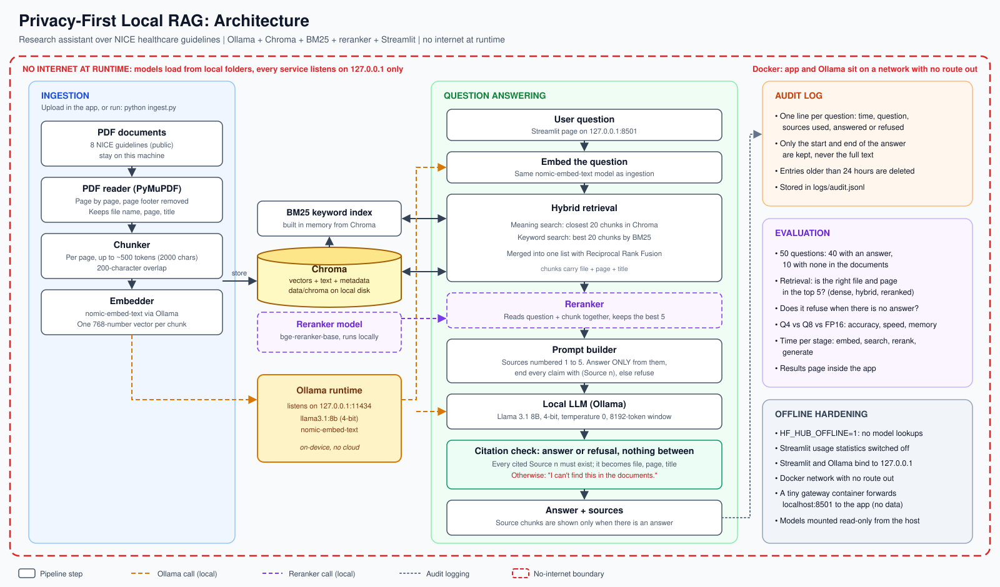

# Privacy-First Local RAG

A research assistant that answers questions about healthcare guidelines (8 NICE guidelines) **entirely on your own machine**. The documents, the search index, the AI model and the questions never leave the computer, and at runtime nothing needs the internet.

Ask a question, get an answer with the file, page and title it came from. If the documents don't contain the answer, it says **"I can't find this in the documents."**



**Stack:** Ollama (Llama 3.1 8B, 4-bit, plus `nomic-embed-text`), Chroma, PyMuPDF, BM25 (`rank-bm25`), a `bge-reranker-base` reranker, Streamlit, Docker Compose.

---

## How it works

1. **Ingest:** each PDF is read page by page, split into chunks of about 500 tokens, turned into vectors by `nomic-embed-text`, and stored in a local Chroma database together with the file name, page and title.
2. **Search (hybrid):** a question is searched two ways: by meaning (vectors) and by keywords (BM25). The two lists are merged with Reciprocal Rank Fusion.
3. **Rerank:** a reranker model reads the question together with each candidate chunk and keeps the best 5.
4. **Answer:** the 5 chunks are numbered "Source 1" to "Source 5" and sent to Llama 3.1 with the instruction to answer only from them and cite `(Source n)`.
5. **Check:** the answer is shown only if every cited source number exists. The numbers are replaced by the file, page and title. Otherwise the app says it can't find the answer. There is no in-between.
6. **Audit log:** each question is logged (time, question, sources, answered/refused, and only the start and end of the answer). Entries older than 24 hours are deleted.

---

## Results

All numbers come from the scripts in this repository. The test set has **50 questions**: 40 whose answer is in the documents and 10 whose answer is not. I wrote the questions myself, so treat the results as a check that the pipeline works, not as proof it never misses.

### Retrieval: is the right file and page in the top 5?

| Search method | Question set 1 (30) | Hard set (10) |
|---|---|---|
| Vectors only (dense) | 25 / 30 | 8 / 10 |
| + keywords (hybrid) | 30 / 30 | 9 / 10 |
| + reranker | **30 / 30** | **10 / 10** |

With every method the model refused all 10 unanswerable questions (10 / 10).

### Model size: Q4 vs Q8 vs FP16

Same 5 chunks given to every model, temperature 0, measured on an Apple Silicon laptop with 64 GB RAM.

| Model | Answers correct (40) | Refusals correct (10) | Decode speed | Prompt speed | Memory |
|---|---|---|---|---|---|
| **Q4** (`llama3.1:8b`) | 40 / 40 | 10 / 10 | **83.5 tokens/s** | 837 tokens/s | **6.0 GB** |
| Q8 | 40 / 40 | 10 / 10 | 52.1 tokens/s | 776 tokens/s | 9.3 GB |
| FP16 | 40 / 40 | 10 / 10 | 29.5 tokens/s | 718 tokens/s | 16.3 GB |

All three were equally accurate on this set, so the 4-bit model is the best choice here: 1.6x faster than Q8, 2.8x faster than FP16, and a third of the memory of FP16. The test set was too easy to separate the models, so this does not show that Q4 is always as good. Absolute speeds change with how busy the machine is; the order and rough ratios are what to rely on.

### Time per stage (average per question, reranked search)

| Stage | Time |
|---|---|
| Embed the question | ~9 ms |
| Meaning search (Chroma) | ~4 ms |
| Keyword search (BM25) | ~1 ms |
| Rerank (about 40 candidates) | ~270 ms |
| Generate the answer | about 1 to 3 seconds, depending on its length |

The same results are shown as charts on the **Benchmark** page of the app.

---

## Run it on your machine

**You need:** macOS or Linux, Python 3.12 (the only version I tested), [Ollama](https://ollama.com), about 16 GB of RAM and 10 GB of free disk space. Steps 2 and 3 download models and need the internet. Everything after that works offline.

**1. Get the code and install the packages**

Check your Python first with `python3 --version`. Plain `python3` is often too old (macOS ships 3.9); you need **3.12**. If you don't have it, `brew install python@3.12` or use [uv](https://docs.astral.sh/uv/), which downloads it for you.

```bash
git clone <this repository>
cd <the folder>
python3.12 -m venv .venv          # with uv instead: uv venv --python 3.12 --seed .venv
source .venv/bin/activate
pip install -r requirements.txt   # a few minutes: PyTorch is a large download
```

**2. Download the Ollama models (one time, needs internet)**

```bash
ollama pull llama3.1:8b
ollama pull nomic-embed-text
```

**3. Download the reranker (one time, needs internet)**

```bash
HF_HUB_OFFLINE=0 python -c "from sentence_transformers import CrossEncoder; CrossEncoder('BAAI/bge-reranker-base')"
```

The app never downloads anything by itself: it runs with `HF_HUB_OFFLINE=1`, so this step must be done once, by hand. If it fails with a certificate error, see [Troubleshooting](#troubleshooting).

**4. Add the documents**

The PDFs are not included in this repository. Download them from the NICE website (`https://www.nice.org.uk/guidance/<number>`, then "Download guidance") and put them in `data/docs/`:

| Guideline | Number |
|---|---|
| Hypertension in adults | NG136 |
| Cardiovascular disease: risk assessment and reduction, including lipid modification | NG238 |
| Chronic heart failure in adults | NG106 |
| Chronic kidney disease | NG203 |
| Diabetic foot problems | NG19 |
| Diabetic retinopathy | NG242 |
| Type 1 diabetes in adults | NG17 |
| Type 2 diabetes in adults | NG28 |

You can use your own PDFs instead. The test questions in `eval_set*.json` only make sense for these 8 guidelines, and the page numbers in them refer to the versions I used (for example, hypertension updated February 2026). A newer version can shift the pages and change the evaluation results.

**5. Start Ollama (leave this terminal open)**

```bash
OLLAMA_HOST=127.0.0.1:11434 ollama serve
```

**6. Index the documents (one time, a few minutes)**

```bash
python ingest.py
```

The index is saved in `data/chroma/`, so you only do this once. You can also upload PDFs later from the sidebar of the app.

**7. Ask questions**

```bash
streamlit run app.py          # then open http://127.0.0.1:8501
python ask.py "What is the clinic blood pressure target for adults aged 80 and over?"   # or from the terminal
```

Next time, only steps 5 and 7 are needed: your documents stay indexed.

---

## Run it in Docker with no internet access

Docker runs the app and Ollama on a network with **no route to the internet**. The models come from your own machine, read-only.

**You need:** Docker Desktop with at least **12 GB of memory** (Settings, Resources), and steps 1 to 4 above (the models and the PDFs must already be on your machine; the reranker in `~/.cache/huggingface`, the Ollama models in `~/.ollama`).

```bash
docker compose up -d                       # first time: builds the image (about 7 GB, several minutes)
docker compose exec app python ingest.py   # first time only: index the PDFs
```

Open http://127.0.0.1:8501.

**Prove that it is offline.** This asks the app container to open a public website. It must fail, while the question below it still works:

```bash
docker compose exec app python -c "import urllib.request; urllib.request.urlopen('https://example.com', timeout=5)"
docker compose exec app python ask.py "What is the clinic blood pressure target for adults aged 80 and over?"
```

Stop everything with `docker compose down`. After you change any code, run `docker compose build` again.

**What to expect:**
- Docker on a Mac cannot use the Apple GPU, so the model runs on the CPU and is slower than on the host. The first question after starting takes about 40 seconds while the models load.
- A network with no internet cannot show a web page in your browser, so a tiny `gateway` container forwards `127.0.0.1:8501` to the app. It stores no data. The app and Ollama have no internet access.
- Your `data/`, `logs/` and `results/` folders are shared with the containers, so the audit log and the index are in the same place as when you run on the host.

---

## Measure it yourself

```bash
python evaluate.py rerank                                   # retrieval + refusals; also: dense, hybrid
python evaluate.py rerank --set eval_set_hard.json          # the harder question set
python benchmark.py                                         # Q4 vs Q8 vs FP16 (about 10 minutes on a quiet machine)
```

`evaluate.py` saves to `results/<question set>_<mode>.json`. `benchmark.py` needs the other two models first:

```bash
ollama pull llama3.1:8b-instruct-q8_0
ollama pull llama3.1:8b-instruct-fp16     # 16 GB download
```

To benchmark one model only, name it: `python benchmark.py llama3.1:8b`. Close other heavy programs first, because speeds change a lot with machine load. The **Benchmark** page of the app reads the files in `results/`.

---

## What is in the repository

| File | What it does |
|---|---|
| `app.py` | The Streamlit page: ask a question, upload PDFs, see the answer and sources |
| `pages/1_Benchmark.py` | The Benchmark page: Q4 vs Q8 vs FP16 charts and an answer comparison |
| `ask.py` | Search, rerank, prompt, answer and citation check. Also usable from the terminal |
| `ingest.py` | Reads PDFs, chunks them, embeds them and stores them in Chroma |
| `audit.py` | The 24-hour audit log |
| `evaluate.py` | Retrieval and refusal tests, with time per stage |
| `benchmark.py` | Compares the three model sizes |
| `eval_set.json`, `eval_set_hard.json` | The 50 test questions with the correct pages and key facts |
| `results/` | Saved evaluation and benchmark results |
| `scripts/inspect_pdfs.py` | Checks how well a PDF's text can be extracted |
| `Dockerfile`, `docker-compose.yml` | The no-internet Docker setup |
| `docs/architecture.svg` | The architecture diagram |
| `data/docs/`, `data/chroma/`, `logs/` | Your PDFs, the index and the audit log (not in git) |

---

## Design decisions

- **Hybrid search with a reranker, not vectors alone.** Vector search misses exact terms such as drug names and numbers. Keyword search catches them. The reranker then picks the truly relevant chunks. Vectors alone found the right page for 25 of 30 questions; the full pipeline for 30 of 30.
- **Chunks never cross a page.** Every chunk has an exact page number, which makes the citations reliable.
- **Numbered sources, expanded by the code.** The model only writes `(Source 2)`. The code turns it into the real file, page and title, so the model cannot invent a file name.
- **Answer or refusal, nothing in between.** An answer without a valid citation is not shown.
- **4-bit model.** Same accuracy as 8-bit and 16-bit on the test set, with far less memory and more speed.
- **No chat history.** Every question stands alone. It keeps the app simple and every answer traceable.
- **No login or roles.** The app is built for one person on one machine and only listens on `127.0.0.1`.
- **Disk encryption is left to the operating system** (FileVault on macOS). The app does not encrypt files itself.
- **The audit log keeps only the start and end of each answer, for 24 hours,** so it cannot grow without limit or hold full sensitive answers.
- **Offline by design and by enforcement.** The code never needs the internet (`HF_HUB_OFFLINE=1`, usage statistics off), and Docker blocks it anyway.

---

## Limits

- **It can miss.** If the right passage is not among the top 5 chunks, the model can't use it and will refuse. On my test questions the right page was always found, but those questions were written by me. Real users will phrase things differently.
- **A valid citation is not proof.** The check confirms the cited source exists, not that it supports the claim. In my checks about 80% of citations pointed to a page I had labelled as correct.
- **The test set is small and easy.** All three model sizes scored 100%, so it cannot show differences in quality.
- **One question at a time.** There is no memory of earlier questions.
- **Only PDFs.** Scanned PDFs without text are not supported.
- **Everything in memory.** The keyword index is rebuilt from Chroma at startup. That is fine for hundreds of chunks, not for millions.
- **Docker is slow on a Mac** because it cannot use the GPU, and the image is large (about 7 GB) because the Linux build of PyTorch bundles GPU libraries.
- **Not a medical device.** It answers from the documents you give it. Do not use it for clinical decisions.

---

## Troubleshooting

| Problem | Fix |
|---|---|
| "Can't reach Ollama" | Start it: `OLLAMA_HOST=127.0.0.1:11434 ollama serve` |
| The reranker download fails with `CERTIFICATE_VERIFY_FAILED` (a company network that inspects HTTPS) | Export your company's certificates and use them for this one command. On macOS: `security find-certificate -a -p /System/Library/Keychains/SystemRootCertificates.keychain /Library/Keychains/System.keychain ~/Library/Keychains/login.keychain-db > ~/company-ca.pem`, then `SSL_CERT_FILE=~/company-ca.pem REQUESTS_CA_BUNDLE=~/company-ca.pem HF_HUB_OFFLINE=0 python -c "from sentence_transformers import CrossEncoder; CrossEncoder('BAAI/bge-reranker-base')"`. Never switch certificate checking off. |
| `OSError` about `bge-reranker-base` when asking a question | Step 3 was not done. The app is offline by design and will not download it. |
| "0 chunks indexed" | Put PDFs in `data/docs/` and run `python ingest.py`, or upload them in the sidebar. |
| Docker: the model is killed or very slow | Raise Docker Desktop's memory to 12 GB or more. |
| Docker: port 8501 already in use | Stop `streamlit run app.py` on the host, or `docker compose down`. |
| Code changes have no effect in Docker | The code is copied into the image. Run `docker compose build`. |

---

## Data and licence note

The NICE guidelines are not included in this repository. Download them from [nice.org.uk](https://www.nice.org.uk/guidance) and check NICE's terms for your use. This project is a learning and portfolio project, and is not medical advice.
